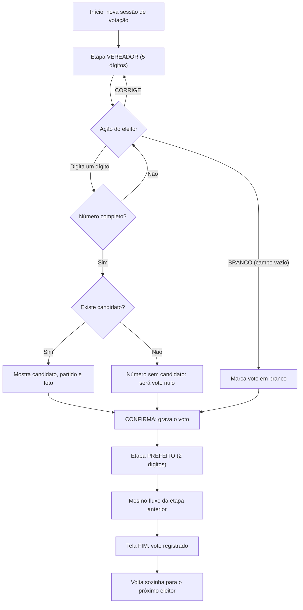
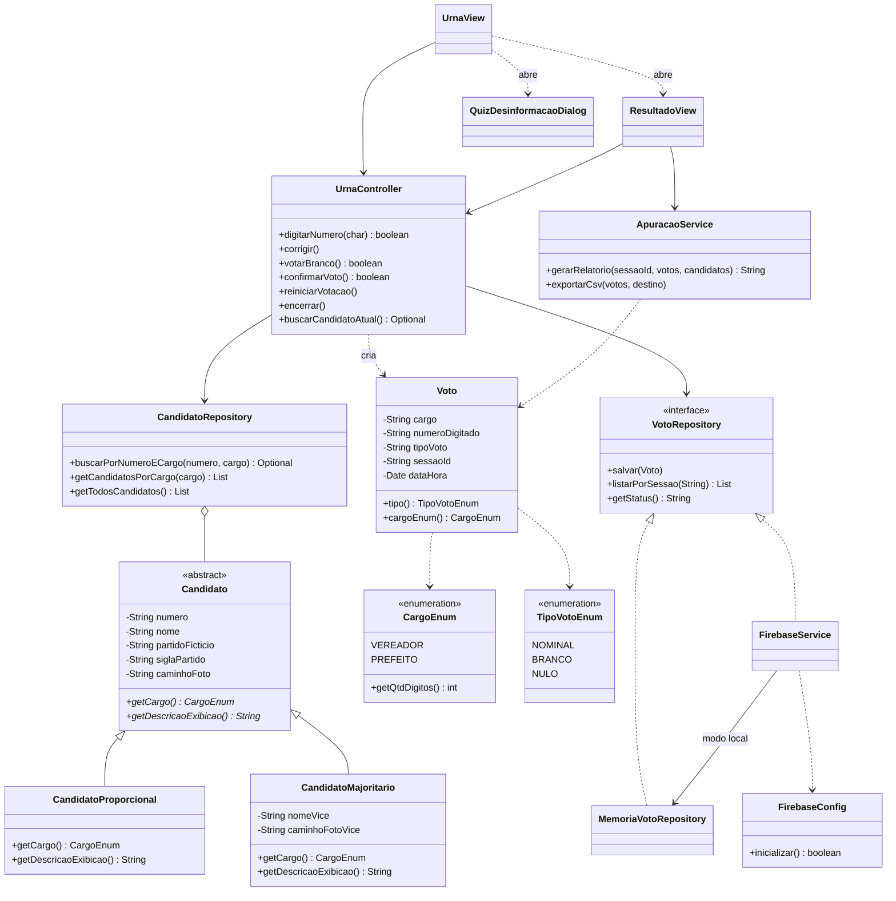

# Documentação — Primeiro Voto

Simulador educativo de urna eletrônica, desenvolvido para o projeto de extensão da disciplina de Programação Orientada a Objetos (UNIJORGE, 2026.2), a partir da proposta **"Urna Cidadã: simulação educativa do voto eletrônico e combate à desinformação em ano eleitoral"**.

> Este software é apenas educativo. Não tem ligação com a urna eletrônica oficial nem com a Justiça Eleitoral. Todos os candidatos, partidos e fotos são fictícios, e a ação é apartidária.

## 1. Visão geral

O **Primeiro Voto** reproduz a lógica de funcionamento da urna eletrônica brasileira de forma simplificada, para ser usado em oficinas com estudantes do Ensino Médio.

- **Votação em sequência** para dois cargos: Vereador (cargo proporcional, 5 dígitos) e Prefeito (cargo majoritário, 2 dígitos, com vice).
- **Teclas** BRANCO, CORRIGE e CONFIRMA, como na urna real, com sons de tecla, confirmação e erro.
- **Persistência em nuvem** dos votos no Cloud Firestore (Firebase), com modo local de reserva.
- **Apuração** por sessão, com exportação em CSV.
- **Atividade de desinformação**: quiz "Verdadeiro ou Falso" com 6 perguntas sobre urna eletrônica, deepfakes e checagem de fatos.

### Tecnologias

| Item | Uso |
|---|---|
| Java 17 | Linguagem do projeto |
| Java Swing | Interface gráfica |
| Cloud Firestore (Firebase Admin SDK) | Armazenamento dos votos em nuvem |
| Maven | Build, dependências e empacotamento do `.jar` |
| JUnit 5 | Testes automatizados |

## 2. Requisitos

### Funcionais

1. Votar em Vereador informando 5 dígitos e, em seguida, em Prefeito informando 2 dígitos.
2. Mostrar nome, partido e foto do candidato (e o vice, no caso de Prefeito) ao digitar um número válido.
3. Permitir voto em **branco**, voto **nulo** (número completo sem candidato) e **correção** antes de confirmar. O voto só é gravado no CONFIRMA.
4. Registrar cada voto com cargo, tipo do voto, número digitado, sessão e data/hora.
5. Voltar sozinha para o próximo eleitor depois da tela de FIM.
6. Separar os resultados por **sessão** (uma por oficina ou turma).
7. Exibir a **apuração** da sessão (por candidato, brancos e nulos, com porcentagens) e exportá-la em CSV.
8. Oferecer o **quiz** sobre desinformação.

### Não funcionais

- **Candidatos fictícios**, sem vínculo com pessoas ou partidos reais.
- **Funcionar sem internet**: sem a chave do Firebase, a urna roda em modo local (memória); se a conexão cair durante a oficina, os votos vão para a fila `votos-pendentes.tsv`.
- **Segurança da chave**: a chave do Firebase não é versionada (`.gitignore`) e é removida do `.jar`.
- A gravação dos votos e a leitura da apuração acontecem fora da thread da interface, para a tela não travar.
- Voto **anônimo**: o voto não guarda nenhum dado do eleitor.

## 3. Casos de uso

| Ator | Caso de uso | Descrição |
|---|---|---|
| Eleitor (estudante) | Votar em Vereador | Digita 5 dígitos, confere os dados do candidato e confirma |
| Eleitor (estudante) | Votar em Prefeito | Digita 2 dígitos, confere candidato e vice, e confirma |
| Eleitor (estudante) | Votar em branco | Com o campo vazio, aperta BRANCO e confirma |
| Eleitor (estudante) | Votar nulo | Digita todos os dígitos de um número sem candidato e confirma |
| Eleitor (estudante) | Corrigir | Aperta CORRIGE e apaga os dígitos (ou o BRANCO) do cargo atual |
| Mediador (equipe) | Definir ou trocar a sessão | Informa o nome da sessão ao abrir (ou por argumento) e em *Oficina → Trocar sessão* |
| Mediador (equipe) | Ver a apuração | *Oficina → Ver apuração* (`Ctrl+R`): contagem por candidato, brancos e nulos da sessão |
| Mediador (equipe) | Exportar resultados | Botão **Exportar CSV** na tela de apuração |
| Mediador / estudantes | Fazer o quiz | *Oficina → Atividade: Verdadeiro ou Falso* (`Ctrl+Q`) |

### Fluxo de votação



### Regras de funcionamento

Estas regras estão implementadas em `UrnaController` e seguem a lógica da urna real:

- O primeiro cargo é **Vereador**; depois de confirmar, a urna passa para **Prefeito**; depois de confirmar o segundo voto, a votação termina (tela FIM) e a urna reinicia para o próximo eleitor.
- A quantidade de dígitos vem do cargo (`CargoEnum.getQtdDigitos()`): 5 para Vereador e 2 para Prefeito. Dígitos além do limite e caracteres que não são dígitos são ignorados.
- **BRANCO** só vale com o campo vazio. Se já houver dígito, a urna avisa para apertar CORRIGE antes.
- Depois de marcar BRANCO, não é possível digitar números sem apertar CORRIGE antes.
- **CONFIRMA** só funciona com o número completo ou com BRANCO marcado. Com número incompleto, a urna avisa: "Digite o número completo ou aperte BRANCO."
- Número completo que existe no cadastro vira voto **NOMINAL**; número completo sem candidato vira voto **NULO**.
- **CORRIGE** apaga todos os dígitos digitados e desmarca o BRANCO.
- Depois da tela FIM, a urna não aceita mais ações até reiniciar para o próximo eleitor.
- O voto é gravado em **outra thread** (`gravador-votos`), para a interface não travar. Ao fechar a urna, `encerrar()` espera até 15 segundos pelas gravações pendentes.
- A sessão pode ser trocada durante o uso, e os votos seguintes passam a ser gravados na nova sessão.

## 4. Arquitetura (MVC + camada de serviço)

O código fica em `src/main/java/br/edu/unijorge/`, organizado em pacotes:

| Pacote | Responsabilidade | Classes |
|---|---|---|
| `model` | Entidades e enumerações | `Candidato` (abstrata), `CandidatoProporcional`, `CandidatoMajoritario`, `Voto`, `CargoEnum`, `TipoVotoEnum` |
| `service` | Acesso a dados e regras de apuração | `VotoRepository` (interface), `FirebaseService`, `MemoriaVotoRepository`, `CandidatoRepository`, `ApuracaoService` |
| `controller` | Regras da urna | `UrnaController` |
| `view` | Telas (Swing) | `UrnaView`, `ResultadoView`, `QuizDesinformacaoDialog` |
| `config` / `util` | Configuração e utilitários | `FirebaseConfig`, `SomUrna` |

A classe de entrada é `br.edu.unijorge.Main`. Ela inicia o `FirebaseService` fora da thread da interface (a primeira conexão pode demorar), descobre a sessão (argumento do programa ou caixa de diálogo, com `teste-interno` como padrão) e abre a `UrnaView`.

### Diagrama de classes (simplificado)



### Conceitos de POO aplicados

| Conceito | Onde aparece |
|---|---|
| **Abstração** | `Candidato` (classe abstrata, com `getCargo()` e `getDescricaoExibicao()` abstratos) e `VotoRepository` (interface) |
| **Herança** | `CandidatoProporcional` e `CandidatoMajoritario` estendem `Candidato`; o majoritário acrescenta nome e foto do vice |
| **Polimorfismo** | `getCargo()` e `getDescricaoExibicao()` sobrescritos em cada tipo de candidato; `FirebaseService` e `MemoriaVotoRepository` são intercambiáveis por meio de `VotoRepository` |
| **Encapsulamento** | Atributos privados com getters e setters |
| **Inversão de dependência** | O controller e as telas dependem da interface `VotoRepository`, e não de uma implementação concreta |

### Armazenamento dos votos

- **`FirebaseService`**: tenta inicializar o Firebase com `FirebaseConfig`. Sem chave, cai para o modo local (`MemoriaVotoRepository`) e o rodapé mostra "Modo local (sem Firebase)". Com chave, grava cada voto na coleção `votos_simulacao` (limite de espera de 10 segundos por operação) e o rodapé mostra "Firebase online".
- **Fila offline**: se o envio falhar, o voto vai para uma fila em memória e para o arquivo `votos-pendentes.tsv`. O rodapé passa a mostrar quantos votos estão na fila. A fila é reenviada no **próximo voto** ou na **próxima abertura** do programa, e o arquivo é apagado quando a fila esvazia.
- **Leitura**: a apuração lê os votos da sessão no Firestore e soma os que ainda estão na fila.

## 5. Dados

### Candidatos fictícios (cadastrados em `CandidatoRepository`)

**Vereador (5 dígitos)**

| Número | Candidato | Partido |
|---|---|---|
| 11111 | Ana Silva Fictícia | Partido da Cidadania Criativa (PCC) |
| 22222 | Carlos Souza Fictício | Partido do Futuro Digital (PFD) |
| 33333 | Juliana Rocha Fictícia | Partido Voz da Juventude (PVJ) |
| 44444 | Pedro Nogueira Fictício | Partido Voz da Juventude (PVJ) |

**Prefeito (2 dígitos)**

| Número | Candidato | Vice | Partido |
|---|---|---|---|
| 11 | Mariana Lima Fictícia | Roberto Alves Fictício | PCC |
| 22 | Fernando Costa Fictício | Beatriz Ramos Fictícia | PFD |
| 33 | Helena Prado Fictícia | Davi Moura Fictício | PVJ |

Qualquer outro número completo é registrado como voto **nulo**. As fotos ficam em `src/main/resources/images` (`cand_<número>.png` e `vice_<número>.png`) e são ilustrações genéricas com a tarja "FICTÍCIO".

### Modelo de dados no Firestore

Os votos ficam na coleção `votos_simulacao`. Cada voto é um documento com os campos:

| Campo | Tipo | Descrição |
|---|---|---|
| `cargo` | texto | Cargo votado (`VEREADOR` ou `PREFEITO`) |
| `tipoVoto` | texto | Tipo do voto: `NOMINAL` (em candidato), `BRANCO` ou `NULO` |
| `numeroDigitado` | texto | Número digitado pelo eleitor (nulo no voto em branco) |
| `sessaoId` | texto | Nome da sessão (oficina ou turma) |
| `dataHora` | data/hora | Momento do registro |

O voto não guarda dados do eleitor, então a votação é anônima.

### Apuração e CSV

A apuração mostra, para cada cargo, o total de votos e a contagem (com porcentagem) de cada candidato, de brancos e de nulos. O botão **Exportar CSV** gera um arquivo com uma linha por voto e as colunas:

```
sessao,cargo,tipo_voto,numero_digitado,data_hora
```

## 6. Como executar

**Requisitos:** JDK 17 ou superior (com suporte a interface gráfica) e Maven.

```bash
mvn clean package                                  # compila, roda os testes e gera target/primeiro-voto.jar
java -jar target/primeiro-voto.jar                 # pergunta o nome da sessão ao abrir
java -jar target/primeiro-voto.jar escola-2a-serie # ou já informa a sessão
```

### Atalhos

| Tecla | Função |
|---|---|
| `0` a `9` (teclado comum ou numérico) | Digitar o número |
| `Enter` | CONFIRMA |
| `Backspace` ou `Esc` | CORRIGE |
| `B` | BRANCO |
| `Ctrl+R` | Apuração |
| `Ctrl+Q` | Quiz de desinformação |

### Configuração do Firebase (opcional)

Sem chave, a urna roda em **modo local**. Para gravar na nuvem, gere uma chave de conta de serviço no console do Firebase (com o Cloud Firestore ativado) e informe-a, **sem colocá-la no Git**, de um destes modos (em ordem de prioridade):

1. variável de ambiente `FIREBASE_CONFIG_PATH=/caminho/para/chave.json`;
2. arquivo `firebase-key.json` na pasta de onde o programa é executado;
3. `src/main/resources/firebase-key.json` (apenas para desenvolvimento; está no `.gitignore` e é removido do `.jar`).

O `.gitignore` também ignora `votos-pendentes.tsv` e arquivos `*.csv`, para que dados da oficina não sejam enviados ao repositório por engano.

## 7. Testes

O projeto tem **23 testes automatizados** (JUnit 5), todos passando em `mvn clean package`.

| Classe de teste | Testes | O que verifica |
|---|---|---|
| `UrnaControllerTest` | 12 | Votos nominal, nulo e em branco nos dois cargos; número incompleto não confirma; limite de dígitos; caracteres que não são dígitos; BRANCO só com campo vazio e gravado apenas no CONFIRMA; não digitar depois do BRANCO sem corrigir; CORRIGE; reinício da votação; nenhuma ação depois do FIM |
| `CandidatoRepositoryTest` | 7 | Busca por número e cargo; número de vereador não serve para prefeito; número inexistente; tamanho e unicidade dos números por cargo; todos os candidatos são fictícios; vice sem marcador duplicado; fotos existem nos recursos |
| `ApuracaoServiceTest` | 3 | Contagem por candidato, brancos e nulos; apuração sem votos não divide por zero; CSV com cabeçalho e uma linha por voto |
| `MemoriaVotoRepositoryTest` | 1 | Separação dos votos por sessão |

```bash
mvn test
```

## 8. Uso na oficina

- Use um nome de sessão próprio para cada oficina ou turma (por exemplo, `escola-x-2a-serie-12nov`), para separar os resultados.
- Teste com antecedência, inclusive sem internet. Se a conexão cair, os votos vão para `votos-pendentes.tsv` e são reenviados no próximo voto ou na próxima abertura do programa. **Não apague esse arquivo antes de a fila esvaziar.**
- Ao final, abra a apuração (`Ctrl+R`) e exporte o CSV para o Relatório Final (Desafio 3).
- Use o quiz (`Ctrl+Q`) na roda de conversa sobre desinformação.

## 9. Limitações

- É uma simulação simplificada, sem identificação de eleitor, biometria, urna de contingência ou qualquer mecanismo de segurança da urna real.
- Há apenas dois cargos, com poucos candidatos fictícios.
- O quiz não registra as respostas dos estudantes.
- O resultado serve para fins pedagógicos e não tem valor eleitoral.

## 10. Equipe

- Thiago Soares
- Adriano Neves
- Erica Mendonca

Projeto desenvolvido com base na proposta do professor Nirton Afonso de Oliveira Filho (UNIJORGE).
